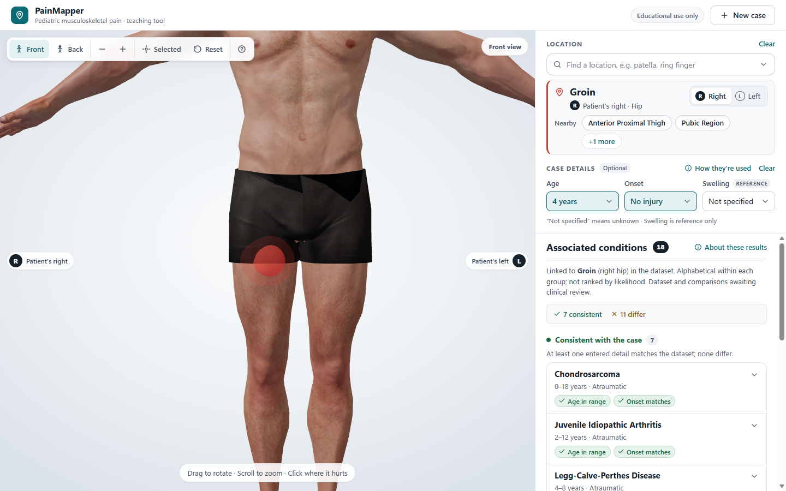
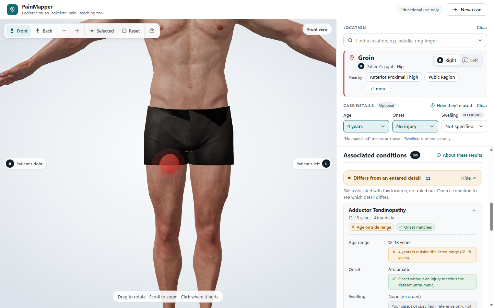
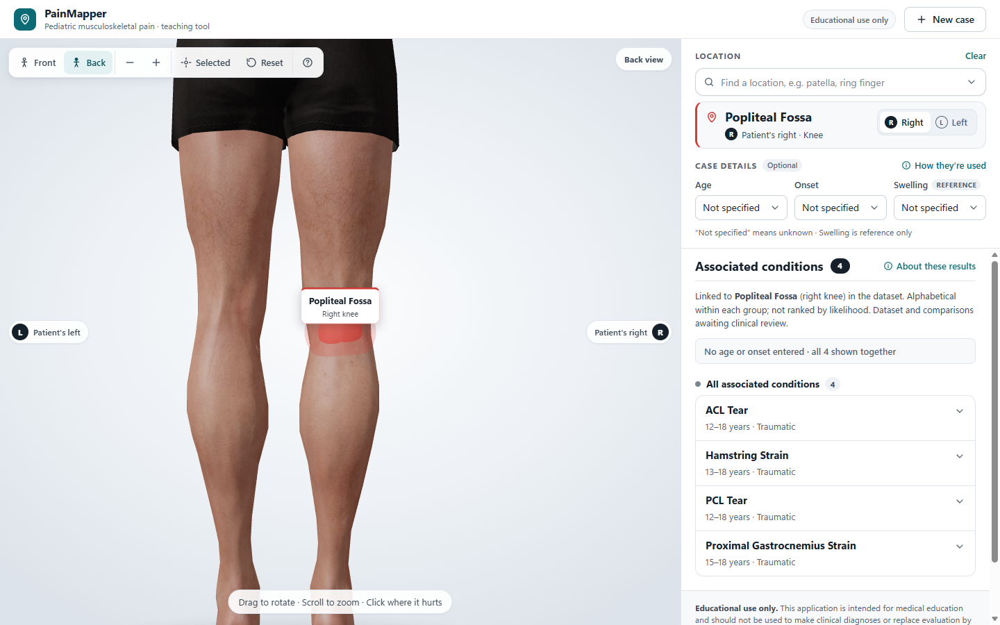
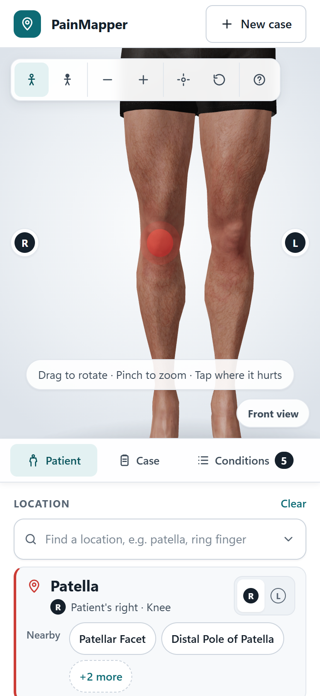
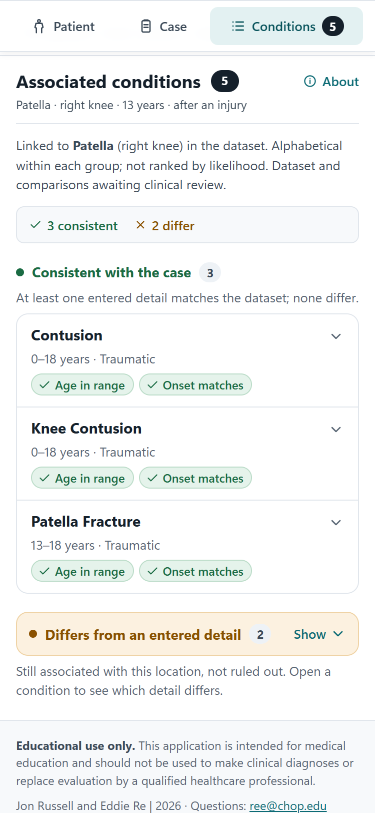

# PainMapper: Milestone 3, finished learner experience

**Date:** 18 November 2026 (builds on Milestone 2, same day)
**Status:** Local only. Nothing has been published or pushed.
**Unchanged:**
- The medical data (`public/data/*.csv`).
- The spot positions (`src/data/nodePlacements.js`).
- The comparison rules (`src/data/caseMatching.js`).
- The CSV loader.
- The picking code (`src/interaction/`).

All of these are byte-for-byte identical to the Milestone 2 checkpoint. The 3D model file is untouched (still dated 14 July 2026, as downloaded), and so are its pose, position and scale.

Nothing here changes which conditions appear for a location or how they are grouped. `tools/data-checks.mjs` confirms this.

---

## 1. Design decisions

- **One panel instead of numbered steps.** "Location", "Case details (Optional)" and "Associated conditions" are visible together, so learners can work in any order without losing their place.
  - The Milestone 2 summary bar and step headers are gone.
  - Where the case can scroll out of view, the pinned results heading carries a one-line summary instead, e.g. "Patella · right knee · 13 years · after an injury".
- **Three visual languages, kept apart:**
  - **The selected location** is coral-red: the pin, the card's edge, and the spot on the body.
  - **Entered case values** are teal-tinted fields.
  - **Dataset comparisons** are green (consistent), grey (couldn't compare) and amber (differs). Amber rather than red, so "differs" never reads as "ruled out".
- **Changing a detail never moves focus or the scroll position.** Learners see the change in three ways:
  - The tally line flashes.
  - Screen readers hear the new counts.
  - On narrow screens, the count in the section bar pulses.
- **Short facts always visible, explanations on request.** These are always on screen:
  - Under the fields: "“Not specified” means unknown · Swelling is reference only".
  - Under the results heading: "Linked to … in the dataset. Alphabetical within each group; not ranked by likelihood. Dataset and comparisons awaiting clinical review."
  - On the differs group: "Still associated with this location, not ruled out."

  The longer explanations sit behind **How they’re used** and **About these results**.
- **Progress is shown as a percentage only when it is real**, i.e. when the server states the file size and sends it uncompressed. Otherwise the loader shows "X MB received", then "Preparing the model…".
- **Focus always lands somewhere sensible**, so keyboard and screen-reader users don't get lost:
  - After choosing a location, focus goes to its name.
  - After New case or Clear, it goes to the search, with its list closed.
  - After "+N more", it goes to the first newly shown location.
  - After a failed retry, it goes back to "Try again".

## 2. What changed

### 3D viewer
- **Toolbar:** Front, Back, zoom out and in, **Selected** (re-frames the chosen spot), Reset, and **?** (help card). On narrow viewers it shows icons only; screen readers still get the full names.
- **R / L markers** sit at the viewer's edges and swap in the back view; narrow screens show the letters only. A pill names the current view.
- **Look:** softer lighting that follows the camera, a floor shadow and a soft backdrop. None of these can be clicked, so selection is unaffected (see the selection check below).
- **Selected spot:** marked by a red halo that gently pulses.
- **Choosing from the search** turns the patient if the spot is hidden, frames it to the size of its region (close for fingers, wider for the trunk), and briefly labels it, e.g. "Popliteal Fossa / Right knee". The side switch and Nearby buttons also turn and label, keeping the zoom.
- **Reset** returns to a front view that fits the window. The default view re-fits when the window is resized.
- **Camera moves** glide along an arc. With the operating system's "reduce motion" setting on, they happen instantly, the halo stays still, and on-screen animations are switched off.

### Case panel
- **Location:** a search box ("Find a location, e.g. patella, ring finger"), then a card showing:
  - the name, and a side line such as "R Patient's right · Knee";
  - a Right/Left switch;
  - the two closest **Nearby** locations, plus "+N more".
- **Case details:** Age, Onset and Swelling in one row, with **How they’re used** and **Clear**.
- **Wording changes:**
  - The onset choice "After an injury" is now "After injury". The rule is unchanged.
  - Swelling is tagged "Reference".

### Results
- **Header:** the heading with its count, **About these results** (just "About" on narrow panels), and the short explanation.
- **Tally line:** e.g. "7 consistent · 11 differ", or "No age or onset entered · all 18 shown together".
- **Groups:** the same as Milestone 2, alphabetical within each:
  - Consistent with the case.
  - Couldn’t be compared.
  - Differs from an entered detail.
- **Badges:**
  - Age in range / Age outside range / Age range not recorded.
  - Onset matches / Onset differs / Onset not recorded.
- **"Differs" group:** still collapsed by default, with its count and note visible. **The exception:** when it is the only group (every condition differs), it opens so the list doesn't look empty.
- **An opened condition shows:**
  - Each comparison as a sentence.
  - The recorded swelling beside the case's (reference only).
  - The other linked locations.
  - "Source for review: pathologies.csv, row N".
- **Empty and waiting states:**
  - No location chosen yet.
  - A location with no linked conditions, which offers nearby locations that have some, with their counts.
  - A loading placeholder.
  - A data error.

### Layouts
| Screen | Behaviour |
|---|---|
| Desktop, 1280 px wide or more and taller than 760 px | Viewer on the left, panel on the right. Case area fixed; results scroll in their own area under a pinned heading. |
| Short laptops, or 881–1279 px wide and 900 px tall or less | The whole panel scrolls as one, so results are never squeezed. The pinned heading shows the case summary. |
| 880 px wide or less (tablet portrait, narrow windows, phones) | Viewer on top, then a sticky **Patient / Case / Conditions (count)** bar that jumps to each part. |
| Touch screens | Larger controls (44 px) and chips. |

### Loading and error states
- **3D model:**
  - A progress card while it loads.
  - If it fails, a card with **Try again** and **Use the search**. The rest of the app keeps working, and the panel's prompts point to the search instead of the patient.
- **Data:** a banner with **Try again** at the top of the panel, and the search disabled with the reason.

### Files (compared with the Milestone 2 checkpoint)
- **Added:**
  - `src/motion.js`, `src/modelLoader.js`.
  - `src/components/`: `CasePanel.jsx`, `ConditionResults.jsx`, `SectionNav.jsx`, `ViewerLights.jsx`, `FloorShadow.jsx`.
  - `docs/screenshots/` (5 images) and this note.
- **Changed:**
  - `src/App.jsx`, `src/App.css`, `src/index.css`.
  - `src/data/zones.js`: framing size per region and an R/L helper.
  - Components: `BodyInteraction`, `CameraControls`, `icons`, `LocationPicker`, `Model`, `ViewerPanel`, `Zone`.
  - `docs/README.md`.
- **Removed:** `CaseSummaryBar.jsx`, `LocationStep.jsx`, `CaseDetailsStep.jsx`, `ConditionsStep.jsx` and `StepHeader.jsx`. `CasePanel` and `ConditionResults` replace them.

## 3. How it was checked (18 November)

**Automated (on the final code):**
- `node tools/data-checks.mjs`: **507 passed, 0 failed.** For example, Groin, age 4, no injury gives 7 consistent and 11 differ, as in Milestone 2.
- `tools/selection-check.js`: **identical to Milestones 1 and 2.**
  - 77,850 simulated clicks.
  - Belly button → Epigastric Region.
  - No unselectable locations.
  - All Toes MTP Joint is reachable only via Nearby.
  - Ring finger is rarely hit (8 times).
  - **0 wrong-side selections.**
- Lint passes and the production build succeeds. The development-only failure switches are absent from the build.

**Journeys, clicked through in the built-in browser (Chromium):**

| Journey | Result |
|---|---|
| Click the left kneecap, then age 13 + after injury | Patellar Facet, "L Patient's left · Knee". 2 consistent / 6 differ. Focus stayed in the field and the results didn't scroll; the announcement read the new counts. |
| Side switch, by mouse and by keyboard | Details kept; focus stays on the switch. |
| Search "popliteal" while facing front | Turned to the back with the "Popliteal Fossa / Right knee" label; R/L markers swapped; focus on the location name. |
| Ring finger from the search, at phone size | Zoomed to the hand with its label. The empty state offered nearby locations with their counts. |
| Many conditions: Groin, age 4, no injury | 7 consistent / 11 differ. An opened condition showed its sentences and source row. |
| Every condition differs: Popliteal Fossa, age 4, no injury | "Differs" opened by itself. |
| Clear details, then New case | Clear: details reset, location kept, focus on Age. New case: everything cleared, front view, cursor in the search with its list closed. |
| Keyboard only (1280×800) | Tab order: New case, Front, Back, Zoom out, Zoom in, Selected, Reset, Help, search, panel. "New case" and "Selected" are skipped while there is nothing to clear or show. Arrow keys + Enter choose. Escape closes the list, then clears the text. Enter opens conditions and groups. No action dropped focus. |
| Model failure (`?simulate=model-error`) | Card announced. "Use the search" opens the list. Groin was still selectable with all 18 conditions. Try again showed loading, then the card again, with focus back on Try again. |
| Data failure (`?simulate=data-error`) | Banner announced; search disabled with a reason. Try again keeps focus if it fails again and moves it to the search when it succeeds. |
| Reduced motion (forced in the page) | The camera jumps in one step instead of about 34; the halo stays still. |

**Sizes:** 1440×900, 1366×650, 1280×800, 1024×768, 900×700, 768×1024, 720×450 (a 1440×900 window at 200% zoom), 375×812 and 320×640.
- At every size: no sideways scrolling, no clipped lists, nothing hidden under the sticky bars.
- At 320 px, "About" moves to its own line.

**Screenshots** were rendered at full resolution from the local preview by Microsoft Edge (headless).

**Bugs found while testing and fixed:**
1. Hidden screen-reader text made the panel scroll by itself at about 1000×750.
2. On short laptops the results area was cramped, which led to the single-scroll layout.
3. Pressing "+N more", the details **Clear**, or either **Try again** dropped keyboard focus to the page.
4. The side switch lost keyboard focus.
5. After New case or Clear, the search list popped open over the panel.
6. "Click where it hurts on the patient" was shown when the model had failed.
7. On phones, the section bar's Conditions icon was squeezed and the results heading wrapped.
8. When every condition differed, the results looked empty.
9. "After an injury" was cut off in its dropdown, and the Swelling label misaligned the row.

**Not checked:**
- Real phones or tablets (touch was only emulated).
- Safari and Firefox. Edge only rendered the screenshots.
- A real screen reader. Only the structure, labels and announcement text were inspected.
- Windows High Contrast mode.
- Slow connections, or the live GitHub Pages host.
- The operating system's reduce-motion switch itself. That setting was forced inside the page; the stylesheet rule and the camera-damping switch (read when the page opens) were inspected only.

## 4. Limitations

- **The model:** still an adult man, about 54 MB. In some back views a small light speck shows on the back of the head. It comes from the model's layered hair, not the lighting.
- **Clicking the body** re-centres on the spot, which can push the head out of view. This is existing behaviour; Reset brings it back.
- **Progress on GitHub Pages:** because it sends compressed files, the loader will show MB received rather than a percentage. This has not been tested live.
- **Keyboard:** the 3D view itself still can't be operated by keyboard. The toolbar and the location search are the keyboard path.
- **Developer options** are still collapsed in the footer.

## 5. For Eddie: still open

All questions in Milestone 2 §3 and the baseline report remain unanswered, and this milestone deliberately does not settle any of them:
1. Age ranges as inclusive limits.
2. Onset flags taken literally (Femoral Neck Fracture; the calcaneal and distal tibia and fibula fractures).
3. The meaning of the Swelling column.
4. Ordering, and flags for "can't-miss" conditions.
5. Whether "Differs" should start open. **New presentation detail:** it now opens by itself when it is the only group. This changes no grouping, but it is Eddie's call.
6. Ages 19–21.
7. The anatomical items carried forward: overlapping spots, the belly button, the kneecap layout, empty locations, and the rows and spellings to confirm.

**Learner-facing wording to glance at** (no new medical content):
- "After injury".
- The badge and group texts in §2.
- "Still associated with this location, not ruled out".
- "Dataset and comparisons awaiting clinical review".
- The "How they’re used" and "About these results" texts.

## 6. Screenshots

**Desktop, populated (Groin, 4 years, no injury):**

**Desktop, "Differs" opened, one condition expanded:**

**Desktop, chosen from the search (the patient turns to the back):**

**Phone (375×812), patient and case:**

**Phone, conditions (Patella, 13 years, after injury):**

## 7. How to return to the Milestone 2 checkpoint

`.backup/milestone-2-checkpoint-2026-11-18.zip` holds the working Milestone 2 version: 48 files, verified byte-for-byte when saved, with a file list (`CHECKPOINT-MANIFEST.txt`) inside. It leaves out `node_modules` and the 3D model, which haven't changed. A test copy, extracted to a scratch folder, built successfully on 18 November.

1. Stop the dev server (Ctrl+C in its window).
2. Extract the zip over the `PainMapper-main` folder, replacing files. This restores the changed files and the five removed components. It also places `CHECKPOINT-MANIFEST.txt` in the folder, which you can delete.
3. Delete the Milestone 3 additions:
   - `src/motion.js` and `src/modelLoader.js`.
   - In `src/components/`: `CasePanel.jsx`, `ConditionResults.jsx`, `SectionNav.jsx`, `ViewerLights.jsx` and `FloorShadow.jsx`.
   - Optionally, this note and `docs/screenshots/` (documentation only).
4. Run `npm run dev` and open http://localhost:5173/PainMapper/.

The Milestone 1 checkpoint and the original download are still in `.backup/`; see `milestone-2-learner-workflow.md` §7.
